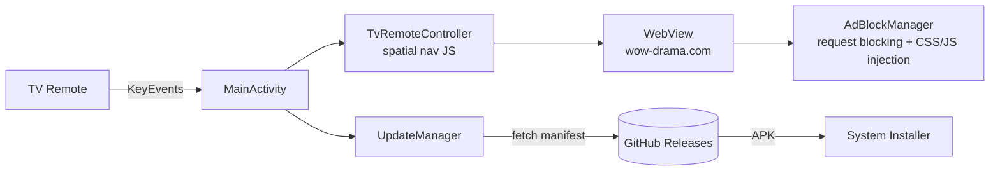

<div align="center">

# 🎬 WOW Drama TV

**A TV-optimized streaming companion for [wow-drama.com](https://wow-drama.com) — built for Chromecast with Google TV**

[](https://github.com/Thanatad/WOW-Drama-TV/releases)
[](https://www.android.com/tv/)
[](https://kotlinlang.org)
[](app-update.json)

[Download the latest APK](https://github.com/Thanatad/WOW-Drama-TV/releases/latest/download/WOW-Drama-TV.apk) ·
[Report an issue](https://github.com/Thanatad/WOW-Drama-TV/issues)

</div>

---

## ✨ Highlights

| | Feature | Description |
|---|---|---|
| 📺 | **Made for the D-pad** | Every screen is fully navigable with the stock Google TV remote — no touch required |
| ⚡ | **Lag-free browsing** | Cached spatial navigation + debounced DOM observers keep card scrolling smooth even on low-end CPUs (yes, the little Chromecast puck) |
| 🛡️ | **Built-in AdBlock** | Thai ad-filter list, network-level request blocking, VAST video-ad skipping, and popup protection |
| 🍿 | **Cinema fullscreen** | Double-press **OK** to jump into a 100% fullscreen player — no grey veils, no paused screens |
| 🔍 | **Remote search** | Quick search overlay reachable from the top bar |
| 🔄 | **Self-updating** | Checks a GitHub-hosted manifest and downloads/installs new versions by itself, or on demand via the **⚙️ อัปเดต** top-bar button |
| 🇹🇭 | **Thai-first UX** | Auto-selects Thai dub, native Thai interface text |

## 🎛️ Remote Controls

| Key | Action |
|---|---|
| **D-pad** | Move between movie cards / episode buttons, or scroll the page |
| **OK / Enter** | Select • **Double-press OK** = enter cinema fullscreen |
| **Back** | Go back • **Double-press** = exit app |
| **OK (in player)** | Toggle play / pause |
| **Left / Right (in player)** | Seek ±10 seconds |
| **Back (in fullscreen)** | Exit fullscreen only — pressing Back again navigates back (never bounces straight back into fullscreen) |
| **⚙️ อัปเดต (top bar)** | Open the update center: check for updates on demand, see current/latest version, install |

## 📲 Installation

1. Grab the newest APK from the
   [**Releases** page](https://github.com/Thanatad/WOW-Drama-TV/releases/latest/download/WOW-Drama-TV.apk)
   (or let the app update itself — see below).
2. Sideload it onto your TV box (e.g. `adb install WOW-Drama-TV.apk`, or via any
   "Downloader"-style TV app).
3. Open **WOW Drama** from the Google TV launcher. First launch asks for
   *"install unknown apps"* permission only when updating itself — nothing else.

## 🔄 In-App Update System

The app polls [`app-update.json`](app-update.json) on `main` (via
`raw.githubusercontent.com`), compares `versionCode`, then offers a one-press
update: **download with live progress → launch system installer → done.**

Releasing a new version is fully automated — just bump the version and push a tag:

```bash
# 1. Edit app/build.gradle.kts
#      versionCode = 6
#      versionName = "1.5"

# 2. Commit + tag
git add -A && git commit -m "v1.5"
git tag v1.5
git push origin main v1.5
```

The [release workflow](.github/workflows/release.yml) then:

1. 🔨 Builds the APK on GitHub Actions (signed with the repo's `debug.keystore`
   so updates install over the existing app)
2. 🚀 Creates a GitHub Release and attaches `WOW-Drama-TV.apk`
3. ✍️ Rewrites `app-update.json` with the new version + APK URL and commits it
   back to `main`

> ⚠️ **Signing note:** updates must be signed with the same key as the installed
> app. This repo intentionally commits `debug.keystore` to keep CI builds
> consistent — fine for a debug-key-distributed app, but don't reuse this key
> for anything sensitive.

## 🗂️ Project Structure

```
app/src/main/java/com/example/
├── MainActivity.kt            # Host activity: WebView, overlays, key routing, update UI
├── adblock/
│   └── AdBlockManager.kt      # Filter parsing, CSS/JS injection, TV layout theme
├── tv/
│   └── TvRemoteController.kt  # D-pad → spatial navigation & page scrolling (cached)
└── update/
    └── UpdateManager.kt       # Manifest fetch, APK download, installer launch
```

## 🛠️ Building Locally

```bash
git clone https://github.com/Thanatad/WOW-Drama-TV.git
cd WOW-Drama-TV
./gradlew assembleDebug        # output: app/build/outputs/apk/debug/app-debug.apk
```

Requires JDK 17 + an Android SDK (`local.properties` with `sdk.dir` is read
automatically by the Android Gradle plugin).

## 🧭 How It Works



- **Key events** are intercepted before the WebView and translated into a
  lightweight, *cached* spatial-navigation script — repeated presses reuse the
  previous element scan, so movement stays responsive on weak TV CPUs.
- **The website itself** is restyled at runtime into a dark "Google TV" grid
  (5–6 poster columns, big focus glow, episode buttons optimized for remotes).
- **Ads** are blocked at three layers: network interception, CSS hiding, and a
  debounced DOM mutation observer.

---

<div align="center">

Made with ❤️ for Thai drama lovers ·
Unofficial fan app for wow-drama.com

</div>
